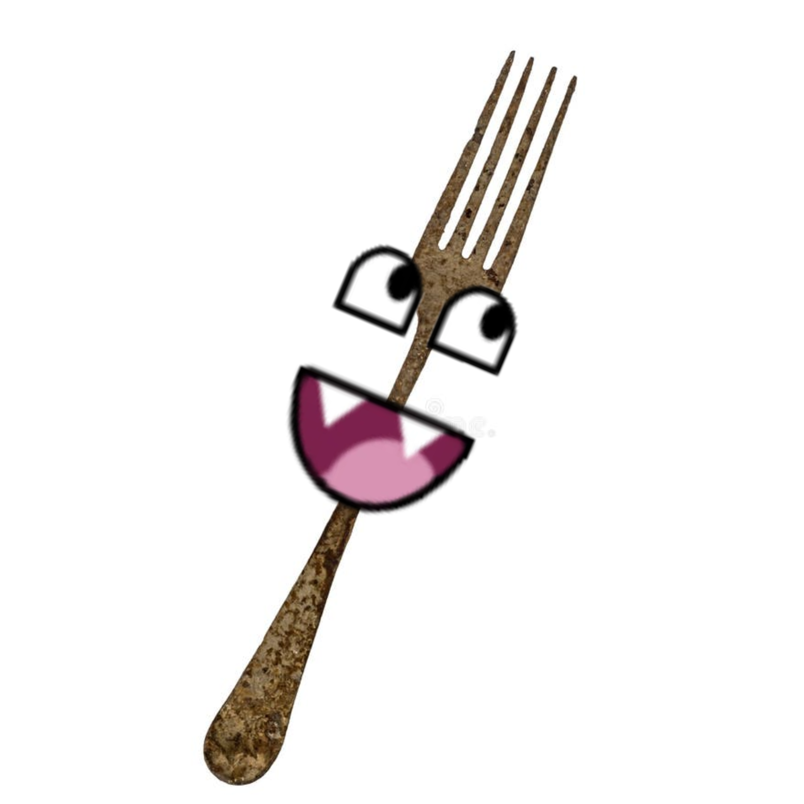

  

# RustGestalt

  <strong>Explore beyond the surface of iOS.</strong>

  An iOS and iPadOS customization, device research, and experimentation toolkit, accompanied by a dedicated macOS application.

  <strong>Customize. Explore. Experiment.</strong>

---

## Introduction

**RustGestalt** is a device customization and research platform designed to explore the capabilities of Apple's iOS and iPadOS ecosystem.

Combining MobileGestalt configuration management, device information, visual customization, retro-inspired experiences, and desktop integration, RustGestalt brings several areas of iOS experimentation together in one application.

Rather than focusing on a single customization, RustGestalt aims to provide a broader environment for understanding, exploring, and personalizing Apple devices.

The project consists of an iPhone and iPad application alongside a companion application for macOS.

Whether you're interested in exploring device capabilities, experimenting with supported system configurations, organizing alternative app icons, or recreating the look and feel of older iOS versions, RustGestalt brings these experiences into one place.

> RustGestalt is an evolving project. Features and compatibility depend on the device, operating system, and individual implementation.

---

# What is MobileGestalt?

One of the central components of RustGestalt is **MobileGestalt**.

MobileGestalt is an Apple system framework and configuration mechanism associated with device-specific information and capability declarations.

In simpler terms, iOS maintains information about the hardware and software capabilities a device reports to the operating system. This information can influence which features iOS makes available and how certain system components behave.

Different iPhone and iPad models can have different capability configurations, even when they run the same version of iOS.

RustGestalt includes a dedicated MobileGestalt Studio that allows users to inspect supported configuration information and manage selected capability values on compatible devices.

### How MobileGestalt customization works

RustGestalt is designed around a staged customization workflow rather than silently changing device configuration.

The general process is:

**1. Device compatibility**

RustGestalt identifies the device and its operating system version and checks whether the relevant MobileGestalt functionality is supported.

**2. Inspect existing configuration**

The application reads available configuration information and presents supported values for inspection.

**3. Select a customization**

Users choose a supported capability or configuration they want to experiment with.

**4. Review proposed changes**

RustGestalt provides a before-and-after review so users can understand which values are being changed.

**5. Create a backup**

Before an eligible write operation, RustGestalt saves the original configuration values so that the corresponding changes can be restored.

**6. Apply the configuration**

The application applies the selected change through its supported on-device access layer.

**7. Verify the result**

RustGestalt reads the configuration back to check whether the requested values were applied successfully.

**8. Restore when necessary**

Users can restore the corresponding saved configuration using the backup created before the change.

This process is intended to make customization more transparent, reviewable, and recoverable.

### Important distinction

Changing a capability declaration does not necessarily create the hardware or software functionality associated with that capability.

For example, enabling a configuration flag does not guarantee that a device has the necessary hardware, drivers, supporting services, or operating-system implementation.

Actual results depend on the device and software build.

---

# Features

## MobileGestalt Studio

The core device-configuration area of RustGestalt.

- Inspect supported MobileGestalt configuration values.
- Review original and proposed values.
- Stage changes before applying them.
- Create backups before supported writes.
- Verify configuration after changes.
- Restore matching saved configurations.
- Enforce operating-system compatibility restrictions.

MobileGestalt functionality is currently restricted to specific supported iOS 27 builds.

See [Compatibility](#compatibility) for details.

## Device Customization

RustGestalt explores device capabilities and supported configuration options.

The broader customization roadmap includes areas such as:

- Always-On Display capabilities.
- Dynamic Island-related capabilities.
- Device model presentation.
- Camera-related capabilities.
- Charging and battery-related configuration.
- Action Button and other device-specific features.

Availability depends on the actual implementation, hardware, and operating-system build. Not every item in the broader roadmap is currently implemented.

## RetroShelf — Icon Library

RetroShelf brings together community-supplied icon artwork inspired by different generations of Apple's software.

The current collection contains **409 supplied icon images** organized around:

- iOS 6
- iOS 7
- iOS 18
- iOS 26

The iOS 18 collection also includes separate Light, Dark, and Tinted artwork sets.

Users can browse the available artwork, select an image, provide a name and destination URL, and prepare a Web Clip configuration profile.

### Web Clips

A Web Clip is a Home Screen shortcut that opens a specified URL.

RustGestalt can generate a configuration profile containing the selected icon and shortcut information.

The user then installs the generated profile through iOS Settings.

**Web Clips do not replace the original icon of an installed application.** They create separate Home Screen shortcuts.

Artwork rights remain with the original creators. See the artwork source documentation before redistributing icon collections.

## Retro Launch Studio

Explore visual experiences inspired by earlier generations of iOS.

Retro Launch Studio provides animated, interactive presentations inspired by:

- iOS 6
- iOS 7
- iOS 18
- iOS 26

The experience is intended for visual exploration, demonstrations, and creative content.

It is not a full operating-system emulator and does not replace the actual iOS interface.

Tapping an icon opens a visual preview rather than launching or modifying a real application.

## macOS Desktop Companion

RustGestalt is designed to work alongside a dedicated macOS application.

The companion is intended to provide a desktop environment for supported device connections, pairing, device inspection, and customization workflows.

The iPhone application currently supports QR-based pairing and manual pairing-code entry.

**Repository scope:** The macOS Companion is a separate component and is not included in this repository at present.

## Creator Studio

RustGestalt also explores the creative side of technology.

Creator Studio is intended to provide a workspace for technology creators, including content planning, device experimentation, and retro-interface presentations.

Its broader direction includes:

- Technology content organization.
- Device testing and comparison.
- Retro iOS demonstrations.
- Creative experimentation.
- Project and idea management.

Features should be considered available only when implemented in the current application.

---

# Device Pairing

RustGestalt supports pairing with the macOS Desktop Companion through a QR-based connection workflow or manual pairing-code entry.

The QR payload contains the information required to identify the companion host and establish a connection.

The application uses certificate fingerprint verification during the pairing handshake and stores the resulting session securely in the device Keychain.

After pairing, the iPhone application can retrieve information such as:

- Device name.
- Product identifier.
- Hardware identifier.
- iOS version.
- Exact operating-system build.

### Current pairing limitations

- The Desktop Companion must be running and reachable.
- The current workflow requires the host information supplied through QR pairing or manual entry.
- Automatic Bonjour host discovery is not currently implemented.
- Pairing requires a compatible local-network connection.

---

# Compatibility

RustGestalt's general application deployment target and its MobileGestalt access requirements are separate.

### Application requirements

| Requirement | Current configuration |
|---|---|
| Platform | iPhone / iPad |
| Minimum deployment target | iOS 17.0 |
| Architecture | arm64 |
| Development environment | Xcode |
| Installation | Developer-signed build |

### MobileGestalt access

The current MobileGestalt access layer is gated to:

- iOS 27.0–27.2.1
- iOS 27.3 beta 1 — build 24C5037i

These restrictions reflect the compatibility range reported by the upstream implementation used as a reference.

They should not be interpreted as independent verification of every device or build within that range.

Other operating-system versions are currently blocked by the application.

Compatibility is subject to change as upstream implementations, operating-system builds, and RustGestalt itself evolve.

### Compatibility terminology

- **Supported:** The feature is enabled for the specified configuration.
- **Tested:** The feature has been exercised on the stated physical device and build.
- **Untested:** Compatibility has not yet been independently verified.
- **Unsupported:** The application intentionally blocks the configuration or the implementation does not support it.

---

# Installation and Building

RustGestalt is currently distributed as source code through this repository.

There is no official signed installation package provided here.

### Requirements

- A Mac capable of running a compatible version of Xcode.
- Xcode and the required Apple development tools.
- An Apple Developer signing configuration.
- A physical iPhone for testing device-dependent functionality.

### Building the application

1. Clone or download the repository.
2. Open `RustGestalt.xcodeproj` in Xcode.
3. Select the RustGestalt application target.
4. Configure signing using your own Apple Developer team.
5. Set an appropriate bundle identifier.
6. Configure the required App Group entitlement.
7. Add the required camera and local-network usage descriptions.
8. Connect a compatible physical device.
9. Build and run the application.

The required App Group is:

`group.com.rustgestalt.app`

Your provisioning profile must include this entitlement for the on-device access layer to operate.

Additional configuration instructions are documented in the project files.

---

# Backup and Recovery

Configuration safety is an important part of RustGestalt's MobileGestalt workflow.

Before a supported configuration write, the application creates a backup containing the original values relevant to that operation.

After writing, the application performs a read-back verification.

A matching backup can be used to restore the saved values.

### Current limitations

- Backups are currently stored locally.
- Backups are not synchronized to the macOS Companion.
- Backups are not automatically transferred to cloud storage.
- Removing the application or losing the device may result in loss of locally stored backups.

Users should not treat an application-level configuration backup as a complete device backup.

---

# Security and Responsible Use

RustGestalt works with areas of iOS that are normally not exposed through ordinary application interfaces.

For that reason, compatibility checks, backups, verification, and transparent limitations are important parts of the project.

The MobileGestalt access layer incorporates selected upstream code from GestaltX. Its upstream origin and scope are documented in:

`RustGestalt/Upstream/GestaltX/UPSTREAM-NOTICE.md`

This functionality has specific operating-system restrictions and should not be assumed to work universally.

RustGestalt is intended for research, customization, and experimentation on devices the user owns or is authorized to manage.

Please review [SECURITY.md](SECURITY.md) before reporting security-related issues.

Never publish signing certificates, provisioning profiles, private keys, authentication tokens, or personal device information in the repository.

---

# Third-Party Credits and Licensing

RustGestalt builds on the work of other developers and community contributors.

### GestaltX

Selected MobileGestalt implementation and access-layer files are adapted from the approved GestaltX fork:

https://github.com/thsrite/gestaltx

Reference commit:

`c6c22fc44da67e5c22e6fd7cf00a1cece4b4376d`

License: GPL-3.0-only.

See the upstream notice included in the source tree for file-level provenance and additional details.

### Logo artwork

The RetroShelf artwork consists of user-supplied community icon collections.

The original creators retain their respective rights. Consult:

`RustGestalt/LogoPacks/Artwork-Sources.txt`

before redistributing artwork or publishing builds containing those assets.

### Project license

The repository is distributed under GPL-3.0-only as documented in the included LICENSE file.

Third-party notices and applicable license obligations must be preserved.

---

# Development Status

**Current stage: Alpha**

RustGestalt is actively being developed.

Its current implementation includes the iPhone application, MobileGestalt Studio, RetroShelf, Web Clip export, Retro Launch Studio, and QR-based Desktop Companion pairing.

Some broader features remain under development or are maintained separately.

Compatibility and functionality should be evaluated against the exact device and operating-system build being used.

The project welcomes feedback, bug reports, testing observations, and constructive contributions.

See [CONTRIBUTING.md](CONTRIBUTING.md) for contribution guidance.

---

# Project Philosophy

RustGestalt is built around a simple idea:

**Your device has more to explore than what appears on its Home Screen.**

We want to make technical experimentation more approachable, customization more understandable, and the history of Apple's software more interactive.

From inspecting device capabilities to revisiting the interfaces of earlier iOS generations, RustGestalt is an ongoing exploration of what makes these devices interesting.

---

  <strong>RustGestalt</strong> 
  Explore beyond the surface of iOS.

